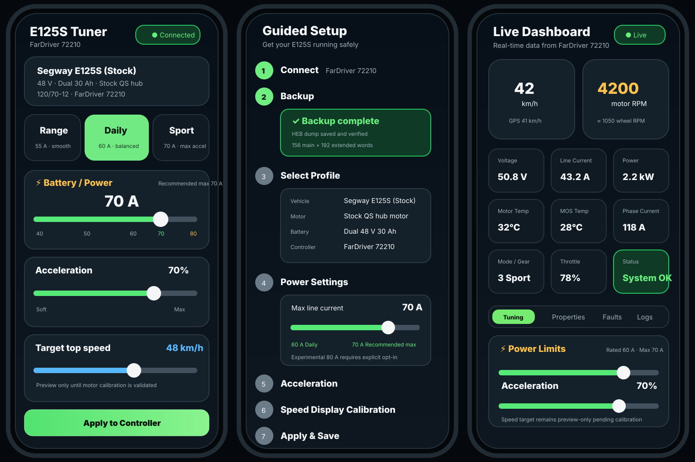
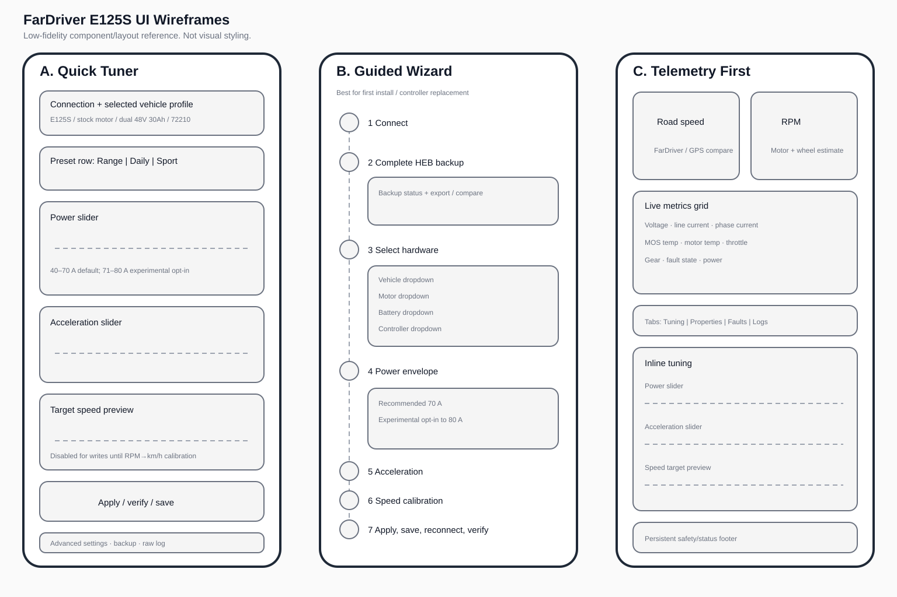

# E125S Web UI concepts

These are design references for the rider-facing FarDriver web app.

## Preferred direction

**Use the Quick Tuner as the default post-setup experience**, with the Guided Wizard available for first install, recovery, or hardware changes. The Telemetry First layout should inform the live dashboard rather than replace the simple tuner.

## Intent

### Quick Tuner
- one-screen everyday tuning
- vehicle/motor/battery/controller profile visible at the top
- Range / Daily / Sport presets
- line-current and acceleration sliders
- normal stock range stops at **70 A**
- explicit experimental opt-in exposes **71–80 A**
- 90 A remains documentation-only for the stock dual-pack profile
- target road speed is visible but remains **preview-only** until motor pole-pair and RPM-to-road-speed calibration are validated

### Guided Wizard
1. Connect.
2. Complete HEB backup.
3. Select vehicle, motor, battery and controller.
4. Apply the hardware power envelope.
5. Tune acceleration.
6. Calibrate the stock Segway display.
7. Apply, save, reconnect and verify.

No automatic multi-register write should bypass the complete-HEB backup gate or per-register verification strategy.

### Telemetry First
Keep the existing diagnostic strengths of the repo:
- road speed / RPM
- voltage
- line and phase current
- power
- controller and motor temperature
- throttle
- gear
- faults
- raw/properties access

## Component mapping

| UI concept | Suggested React component |
| --- | --- |
| Hardware/profile summary | `HardwareProfileCard` |
| Range/Daily/Sport | `TunePresetSelector` |
| Battery current control | `PowerLimitSlider` |
| Acceleration control | `AccelerationSlider` |
| Road-speed preview | `SpeedTargetPreview` |
| HEB/write safety state | `SetupSafetyStatus` |
| First-install flow | `GuidedSetup` |
| Live metric tiles | existing `Dashboard` + metric-card extraction |

The existing `QuickSetup.tsx` is the first implementation pass. These files are the visual target for the next UI cleanup.
